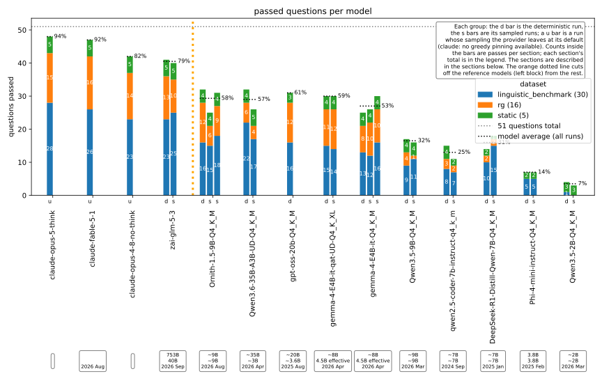

# LLM-Eval

In this project I try to gauge roughly how good the raw reasoning ability of LLMs are, specifically ones able to run on 1 consumer grade GPU (RX 9060 XT 8GB + 32GB RAM for me).
I record results in a CSV from which the result graphs below are made.


### Models tested / in progress

| Model | #b parameters (active/effective) | #b parameters (total) | architecture | thinking | quantization | release date (YYYY-MM) | licence |
| --- | --- | --- | --- | --- | --- | --- | --- |
| `[Done]` [gemma-4-E4B-it-Q4_K_M]() | 4.5B effective | ~8B | Dense | yes, switchable | Q4_K_M | 2026-04 | Apache 2.0 |
| `[Done]` [Qwen3.5-2B-Q4_K_M]() | ~2B | ~2B | Dense | yes, off by default | Q4_K_M | 2026-03 | Apache 2.0 |
| `[Done]` [Qwen3.5-9B-Q4_K_M]() | ~9B | ~9B | Dense | yes, on by default | Q4_K_M | 2026-03 | Apache 2.0 |
| `[Done]` [Ornith-1.5-9B-Q4_K_M]() | ~9B | ~9B | Dense | yes, on by default | Q4_K_M | 2026-08 | MIT |
| `[Done]` [Qwen3.6-35B-A3B-UD-Q4_K_M]() | ~3B | ~35B | MoE | yes, on by default | UD-Q4_K_M | 2026-04 | Apache 2.0 |
| `[Done]` [Phi-4-mini-instruct-Q4_K_M]() | 3.8B | 3.8B | Dense | no dedicated thinking mode | Q4_K_M | 2025-02 | MIT |
| `[Done]` [Qwen/Qwen2.5-Coder-7B-Instruct-GGUF]() | ~7B | ~7B | Dense | no dedicated thinking mode | Q4_K_M | 2024-09 | Apache 2.0 |


#### Results



Regenerate with `uv run analysis.py`.


### Usage & Run configuration

Install the dependencies with `uv install -e .`
Set up `eval.json` (see below) and run:

```bash
uv run eval.py
```

### Run configuration

`eval.json` drives the run. Four keys:

```json
{
  "version": "v2",
  "models": [
    { "name": "Ornith-1.5-9B-Q4_K_M", "base_url": "http://192.168.0.95:8080/v1",
      "model_id": "Ornith-1.5-9B-Q4_K_M", "api_key_env": "API_KEY_LOCAL",
      "params": { "temperature": 1.0, "top_p": 0.95, "top_k": 20,
                  "presence_penalty": 1.5, "max_tokens": 4096 } }
  ],
  "runs": [
    { "name": "det", "temperature": 0.0, "top_p": 1.0, "top_k": 1, "min_p": 0.0,
      "presence_penalty": 0.0, "repeat_penalty": 1.0, "max_tokens": 4096 },
    { "name": "smp", "repeats": 3, "max_tokens": 4096 }
  ],
  "suites": [
    { "name": "static", "prepare": null,
      "data": "data/static/questions1.json", "eval": "default" },
    { "name": "rg", "prepare": "prepare/rg.py",
      "data": "data/prepared/rg.json", "eval": "rg" }
  ]
}
```

- `version`: the active version label, stamped onto every CSV row; compare
  results only within one version
- `models`: one entry per model. `name` is the CSV label, `base_url` +
  `model_id` say where and what to call, `api_key_env` names the env var
  holding the API key (never the key itself), `params` is that model's
  sampling defaults
- `runs`: sampling regimes. "det" pins greedy; all six knobs must stay
  pinned or det inherits the model's settings and stops being
  deterministic. "smp" runs 3 repeats with the model's own `params`.
  Precedence: defaults < model `params` < run
- `suites`: the question sources, run in order. Each entry states its whole
  pipeline: `prepare` (script building the data file, null when
  hand-maintained), `data` (the questions), `eval` (the module in eval/
  that scores them, from the registry in eval.py)


### Requirements

- [Requests](https://pypi.org/project/requests/)
- [Resoning Gym](https://github.com/open-thought/reasoning-gym)


### Goal

We want to evaluate LLMs on their ability to handle logical reasoning problems.
Specifically, for evaluation, the data used needs to be:

- Invariant to if the LLM has been trained on the data or not. This means, the data should for 
  example be procedurally generated, and the generated questions shouldnt be easier to answer if the LLM
  has seen the question setup before.
- Not dependent on certain knowledge. This means, the model shouldnt fail an evaluation simply because for
  example it doesnt know how many legs a crab has.
  -> The model shouldnt be able to get a better result, because it heavily relies on some kind of optmizied algorithm
    to solve a certain puzzle, which other LLMs might not have.
- Not dependent on exact calculations, or tasks other non-AI systems can handle well. The model shouldnt fail
  because it couldnt correctly calculate something or call a calculator tool.
  -> Not involve tool-calls. It should only be evaluated on its inherent reasoning capabilities.

I want to specifically examine models that run on local hardware like consumer GPUs, and track their improvement, as this is most likely the long term most sustainable option to run LLMs.

### Data (51 questions)

1. **General Questions**: *(5 questions)*
  - This is just hand curated with well known logic problems and the most current logic breaking prompts like the car-wash and strawberry question.
  - This is only meant as a sanity check.
  - LLM's passing them is expected, failure is interesting.

2. **Linguistic Benchmark Multiple Choice**: *(30 questions)*
  - Specificall designed for language & logic understanding.
  - It specifically tries to trigger core LLM failures.
  - It wouldnt qualify for our goals, as these questions and their answers *could* have been in the models training data.
  - But, they address very specifically shortcomings of LLMs, and models still fail them, so their are still interesting to evaluate.
  - Here, passing means the model is good at shedding its language model behaviour, and focuses better on logical reasoning.

3. **Reasoning Gym**: *(16 questions, one per puzzle x difficulty)*
  - This is the actually interesting logic test. The puzzles are procedually generated, require no special knowledge,
    involve no tool calls, need no exact calculations, and are invariant to if the LLM has seen the question setup before.
  - Here, interesting is how many questions the model gets right, especially in comparison to other models.
  - Here, we could observe say logical reasoning and model size correlation, correlation of thinking tokens and correct answers, etc.
  - Puzzles selected:
    - `knights_knaves(n_people = 3, depth_constraint = 3)` and increasing of `n_people` and `depth_constraint`
    - `cryptarithm()`
    - `zebra_puzzles(num_people = 4, num_characteristics = 4)`
    - `jugs(num_jugs = 3, difficulty = 5 and 10)`
    - `graph_color(num_colors = 3, num_vertices = 6 and 10)`
    - `course_schedule(num_courses = 5 and 10)`
    - `self_reference(difficulty = 2 and 7)`

### Evaluation

The row for each run in the result CSV has the format:

```
model_name,temperature,top_p,top_k,presence_penalty,max_tokens,score,Q1,Q2,...,QN
```

For each model setup, we run the model once completly deterministically, and then run it again 3 times with reasonable sampling parameters. We then calculate the score as deteministic run +- 5 * std of the 3 samples.


### Question Sources

1. Williams, S., & Huckle, J. (2024, May 30). Easy problems that LLMs get wrong. arXiv.org. [https://arxiv.org/abs/2405.19616](https://arxiv.org/abs/2405.19616)
- Data: [Linguistic Benchmark Multiple Choice JSON](https://github.com/autogenai/easy-problems-that-llms-get-wrong/blob/main/linguistic_benchmark_multi_choice.json)

2. Stojanovski, Z., Stanley, O., Sharratt, J., Jones, R., Adefioye, A., Kaddour, J., & Köpf, A. (2025, May 30). REASONING GYM: Reasoning Environments for Reinforcement Learning with Verifiable Rewards. arXiv.org. [https://arxiv.org/abs/2505.24760](https://arxiv.org/abs/2505.24760)


### To look at

1. Rabern, B., Mondorf, P., & Plank, B. (2026, February 6). LogicSkills: a structured benchmark for formal reasoning in large language models. arXiv.org. [https://arxiv.org/abs/2602.06533](https://arxiv.org/abs/2602.06533)
